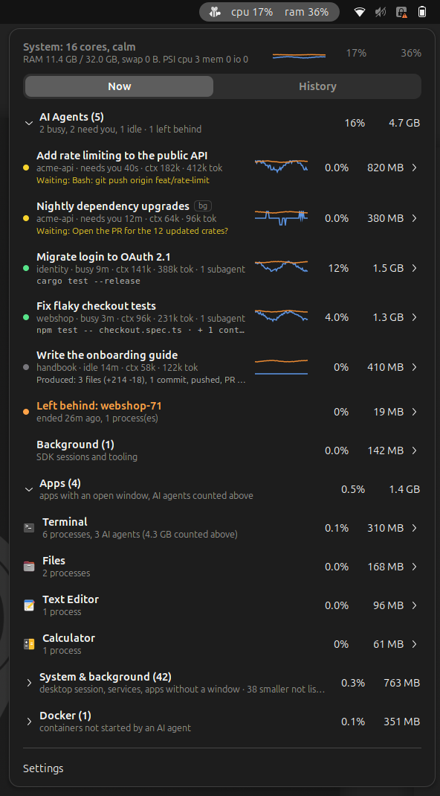
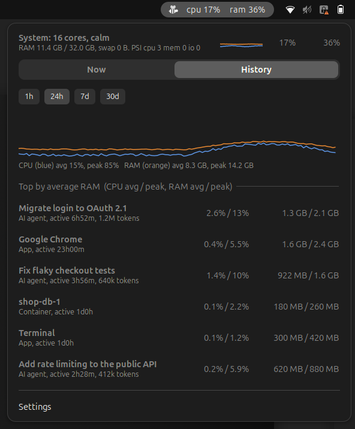

# hivetop

A GNOME top-bar resource monitor for people who run several AI coding agents
at once. It groups CPU and memory by **agent session** (Claude Code today),
**app** and **Docker container**, not by process.

<p align="center">
  
</p>
<br>
<p align="center">
  
</p>

## Features

- 🤖 **AI agents first**: each session with its title, state (busy, idle,
  needs you), context, tokens, subagents and what it produced.
- 🔔 **Needs-you alerts**: a notification when an agent waits for your answer.
- 🧹 **Leftovers**: processes and containers an ended session left running,
  ready to kill.
- 🪟 **Apps by window**: apps you work with on top, desktop and background
  services grouped apart.
- 🐳 **Docker**: containers grouped by Compose project, or under the agent
  that started them.
- 📈 **History**: 30 days of CPU and RAM, and the top consumers.
- 🐝 **Pressure at a glance**: the top-bar bee turns yellow or red under CPU,
  memory or IO pressure.
- ⌨️ **CLI**: the same data in the terminal.

## Install

Needs GNOME Shell 45+, cgroup v2 and a Rust toolchain.

```sh
./install.sh             # build, install, start the daemon
./install.sh --uninstall
```

Log out and back in once: on Wayland, GNOME loads new extensions only at login.

## Use

Click the bee in the top bar. From a terminal:

```sh
hivetop status
hivetop history --range 7d
hivetop kill <agent|pid>
```

Settings: `~/.config/hivetop/config.toml`, see
[`dist/config.example.toml`](dist/config.example.toml). Design notes:
[`docs/design.md`](docs/design.md).

## License

MIT, see [`LICENSE`](LICENSE).
