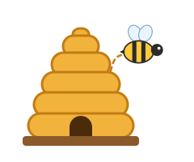

<p align="center"></p>

# hivetop

A GNOME top-bar resource monitor that groups CPU and memory by AI agent
session (Claude Code today), app and Docker container.

## Install

Needs GNOME Shell 45+, cgroup v2 and a Rust toolchain.

```sh
./install.sh             # build, install, start the daemon
```

Log out and back in once: on Wayland, GNOME loads new extensions only at login.
Remove with `./install.sh --uninstall`.

## Use

- **Top bar**: `cpu` and `ram` usage. The bee turns yellow or red under CPU,
  memory or IO pressure.
- **Menu**, tab **Now**: AI agents with their title, state (busy, idle,
  needs you), context, tokens, outputs and subagents; background jobs;
  processes left behind by ended sessions; apps (agents left out); Docker.
  Tab **History**: 30 days of CPU and RAM, top consumers.
- **CLI**: `hivetop status`, `hivetop history --range 7d`, `hivetop kill <agent|pid>`.
- **Config**: `~/.config/hivetop/config.toml`, see [`dist/config.example.toml`](dist/config.example.toml).

Design notes: [`docs/design.md`](docs/design.md).
